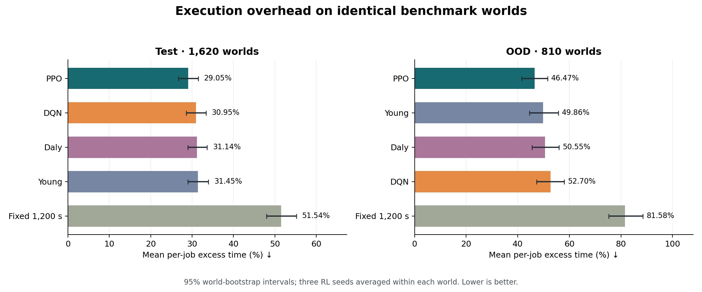
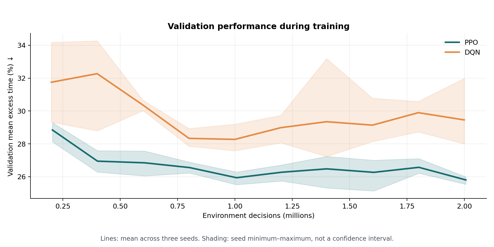

# SmartCheckpoint: reinforcement learning for checkpoint scheduling

PPO and Double DQN learn when to checkpoint a running job. The objective is to
finish required computation with low execution overhead while retaining reliable
completion under failures. Both agents learn from environment rewards. Young,
Daly and Fixed 1,200 s are evaluation baselines only.

This standalone submission contains **five strategies**, the complete environment
and training code, four ready-to-load data splits, six trained agent files (three
seeds per RL strategy), reference run records, metrics and figures.

| Strategy | Test excess % | OOD excess % | Test / OOD completion % |
| --- | ---: | ---: | --- |
| PPO: grid + fractions | **29.05** | **46.47** | 100.00 / 100.00 |
| Double DQN: trained grid | 30.95 | 52.70 | 100.00 / 99.92 |
| Young | 31.45 | 49.86 | 100.00 / 99.88 |
| Daly | 31.14 | 50.55 | 100.00 / 100.00 |
| Fixed 1,200 s | 51.54 | 81.58 | 99.94 / 99.88 |

Lower mean per-job excess is better. Results pool all three RL training seeds;
this is not an ensemble. OOD means out-of-distribution: conditions shifted from
training. These test suites were previously evaluated, so the comparison is
benchmark evidence rather than an unseen confirmation. See [full results](results/RESULTS.md),
[metric definitions](METRICS.md), [methods](METHODS.md) and [data fields](data/README.md).



## Repository layout

```text
checkpoint_rl/       Event simulator, observations, actions, rewards and metrics
agents/              Double DQN, PPO inference adapters and training loops
baselines/           Young, Daly and Fixed 1,200 s
configs/             Environment contract and training hyperparameters
data/                train, validation, test and ood_test JSONL files + checksums
models/              Six selected trained agents + selection manifest
results/             Reference ledgers, learning curves, tables and verification
plots/               Figure generation code
figures/             Five figures, each in PNG and PDF
scripts/             Artifact and reproduction verification
tests/               Environment, learning and reporting contract checks
train.py             Train PPO or DQN from scratch
evaluate.py          Evaluate shipped or newly trained agents
report.py            Recompute metrics and comparisons from run records
run_all.py           Reproduce evaluation, tables and figures without training
```

DQN code is in `agents/dqn.py` (network, replay, optimizer and deployment mask)
and `agents/train_dqn.py` (training loop), with hyperparameters in
`configs/dqn.json` and checks in `tests/test_dqn.py` and `tests/test_support.py`.
PPO code is in `agents/ppo.py` (inference adapter) and `agents/train_ppo.py`
(training loop), with hyperparameters in `configs/ppo.json` and checks in
`tests/test_ppo.py`. `agents/training.py` handles shared validation, checkpoint
selection and output bookkeeping; `train.py` remains the common entry point.

## Installation

Use **64-bit Python 3.13**. CPU execution is sufficient; no GPU, external data
download, credentials, editable package install or old experiment folders are
required. Allow about 2 GB for the Python environment and additional space for
new training checkpoints. Run commands from this repository's root.

Windows PowerShell:

```powershell
py -3.13 -m venv .venv
.\.venv\Scripts\python.exe -m pip install -r requirements-lock.txt
.\.venv\Scripts\python.exe -m pip check
```

Linux/macOS:

```bash
python3.13 -m venv .venv
.venv/bin/python -m pip install -r requirements-lock.txt
.venv/bin/python -m pip check
```

Below, `python` means the virtual environment's interpreter. Activate it with
`.\.venv\Scripts\Activate.ps1` (PowerShell) or `source .venv/bin/activate` (bash).
If PowerShell activation is restricted, replace `python` with
`.\.venv\Scripts\python.exe`; no execution-policy change is necessary.

`requirements.txt` pins the direct dependencies: NumPy, PyTorch, Gymnasium,
Stable Baselines3, sb3-contrib and Matplotlib. `requirements-lock.txt` also pins
their resolved dependencies. The checked platform is recorded in
[verification](results/REPRODUCTION.md). Other platforms can have small floating-point
differences; exact retraining across different systems is not guaranteed.

## Quick checks, including actual training

Use new output folder names when repeating commands. Existing experiment output
and shipped models are protected against accidental overwrite.

```bash
python -m scripts.verify
python -m unittest discover -s tests -v
python train.py --agent ppo --smoke --output runs/ppo-smoke
python train.py --agent dqn --smoke --output runs/dqn-smoke
python evaluate.py --selection runs/ppo-smoke/selection.json --limit 81 --output runs/ppo-smoke-evaluation
python evaluate.py --selection runs/dqn-smoke/selection.json --limit 81 --output runs/dqn-smoke-evaluation
python evaluate.py --limit 81 --output runs/evaluation-smoke
python -m scripts.verify --evaluation runs/evaluation-smoke
```

The smoke commands perform real optimizer updates, validation, model saving and
loading. PPO uses 512 decisions with smaller rollout settings; DQN uses 8,192
decisions and passes its 4,096-transition replay warmup. Both validate on the first
81 validation worlds and retain seed 4401. These checks demonstrate that training
runs; their performance is not a final result. Custom-selection evaluation uses
the supplied trained strategy only. The shipped-agent smoke evaluation runs all
five strategies and checks their trajectories against the reference.

To automate these checks and record command logs plus a machine-readable receipt:

```bash
python -m scripts.check_readme --full-evaluation --output runs/readme-check
```

This also runs the full saved-agent evaluation described below, but never full training.

## Reproduce the submitted results without retraining

```bash
python run_all.py --output runs/reproduction
```

This reloads the six shipped models, evaluates all **21,870 runs** (1,620 test and
810 OOD worlds; six RL seeds plus three baselines), compares every measured record
with the reference, and regenerates tables and figures. It writes only under
`runs/reproduction/` and does not call training. Equivalent individual commands:

```bash
python evaluate.py --output runs/evaluation
python -m scripts.verify --evaluation runs/evaluation
python report.py --input runs/evaluation/raw --output runs/reported
python -m plots.make_plots --results runs/reported --output runs/figures
```

To rebuild the packaged tables/figures directly from the saved run records:

```bash
python report.py
python -m plots.make_plots
```

Model and data hashes must match. The reproduction checker compares every run,
including timeouts, losses, checkpoint counters, action counts and failure gaps.
Its floating-point tolerance is `rtol=1e-10, atol=1e-7`; IDs, integer counters and
policy metadata must match exactly. Partial reports require the explicit
`report.py --partial` flag and are labelled as smoke evidence.

## Full training from scratch

These commands are provided for reproducibility; they are **not required** to
evaluate the submitted agents. Each trains three independent seeds
(4401, 4402, 4403), about two million decisions per seed:

```bash
python train.py --agent ppo --output runs/ppo-training
python train.py --agent dqn --output runs/dqn-training
python evaluate.py --selection runs/ppo-training/selection.json --output runs/ppo-new-evaluation
python evaluate.py --selection runs/dqn-training/selection.json --output runs/dqn-new-evaluation
```

For a single seed, append `--seeds 4401`. Full training uses the saved parameters
in `configs/training.json`, `configs/dqn.json` and `configs/ppo.json`.
It evaluates all 486 validation worlds approximately
every 200,000 decisions and selects the lowest validation mean normalized time,
breaking ties by the earliest checkpoint. Test/OOD data are never read by the
training loop. Learning curves, intermediate models, effective configuration and
the selected model receipt are saved under the chosen output directory.

PPO runs complete rollouts, so its actual full budget is 2,007,040 decisions per
seed; DQN uses 2,000,000. Equal environment decisions do not imply equal compute.
The shipped checkpoints and original training diagnostics remain available even
if retraining on another platform produces different weights.

## Figures

- [Mean overhead with world-bootstrap intervals](figures/overhead.png)
- [Tail risk and completion](figures/tail_risk.png)
- [Writing, lost computation and recovery time](figures/cost_breakdown.png)
- [Validation learning curves](figures/learning_curves.png)
- [Paired PPO differences](figures/paired_comparisons.png)

Each figure also has a PDF version in `figures/`. Error bars resample worlds,
conditional on the saved agents; learning-curve shading is the range across seeds.


